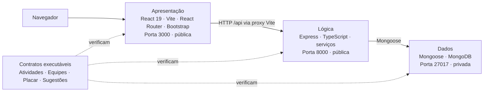

# Arquitetura do OctoFit Tracker

O OctoFit Tracker é uma aplicação de três camadas para um programa de atividades físicas escolar. O código inicial inclui contratos de API e pontos de implementação intencionalmente incompletos para que você use o modo agent do GitHub Copilot em um ciclo guiado por testes.

## Limites entre as camadas

- **Camada de apresentação**: React 19, Vite, React Router, Bootstrap e um cliente compartilhado da API em `octofit-tracker/frontend/src`.
- **Camada de lógica**: rotas e serviços Express com TypeScript em `octofit-tracker/backend/src` expõem o comportamento `/api/*` na porta `8000`.
- **Camada de dados**: modelos Mongoose e dados de demonstração em `octofit-tracker/backend/src/models` e `src/scripts/seed.ts` são persistidos no MongoDB na porta `27017`.

## Portas e regras de ambiente

- MongoDB: `27017` (privada)
- API Express: `8000` (pública)
- Interface Vite: `3000` (pública)
- O navegador acessa caminhos relativos `/api`. O Vite os encaminha para `http://localhost:8000`; `VITE_API_BASE_URL` pode substituir a URL-base.
- Não encaminhe nem torne públicas outras portas.

## Contrato da API

| Capacidade | Método e caminho | Comportamento esperado |
| --- | --- | --- |
| Registro de atividades | `GET /api/activities`, `POST /api/activities` | Lista e cria atividades válidas. POST recebe `userId`, `teamId`, `type` e `minutes`; `userId` e `teamId` devem ser IDs bem-formados de uma pessoa e uma equipe existentes, caso contrário a API retorna um 4xx intencional (nunca um 500 causado por erro de conversão). Uma atividade criada armazena `user`, `team`, `type` e `minutes` enviados, além de `points` e `occurredAt` calculados. |
| Equipes | `GET /api/teams`, `POST /api/teams` | Lista e cria equipes com integrantes. As equipes criadas e listadas mantêm os valores enviados em `name` e `mascot`. Rejeita uma equipe sem nome com `400`. |
| Placar | `GET /api/leaderboard` | Retorna as equipes ordenadas pela soma dos pontos de suas atividades, da maior para a menor. Cada item contém `teamName`, `totalPoints` e uma `rank` iniciada em 1. |
| Sugestões de treino | `GET /api/workouts/suggestions/:userEmail` | Recomenda treinos com base nos padrões de atividade recentes da pessoa correspondente ao e-mail seed. O foco da primeira sugestão (`focus`) corresponde à meta ou à atividade recente dessa pessoa, e o campo `reason` explica o motivo. Um e-mail sem pessoa correspondente retorna um 4xx intencional (por exemplo, `404`). |

## Decisões de implementação

- **Decisão da camada de apresentação:** manter componentes React responsáveis pela exibição e usar o cliente compartilhado da API para chamadas HTTP. Cada rota deve apresentar estados acessíveis de carregamento, vazio e erro, além dos dados recebidos.
- **Decisão da camada de lógica:** manter rotas Express como fronteira HTTP e concentrar regras de negócio nos serviços. Validar entradas e referências antes das operações de persistência e retornar erros 4xx intencionais para dados inválidos ou recursos inexistentes.
- **Decisão da camada de dados:** usar modelos Mongoose para validar campos obrigatórios, referências e valores permitidos. Fazer o seed pela aplicação, de forma idempotente, preservando registros não relacionados e mantendo as relações entre pessoas, equipes e atividades.
- **Abordagem para registro de atividades:** validar IDs e existência da pessoa e da equipe antes de criar; persistir os dados enviados e calcular pontos e data da atividade no backend. Entradas inválidas não devem criar registros nem provocar erros 500 de conversão.
- **Abordagem para gerenciamento de equipes:** exigir nome e mascote, manter a lista de integrantes como array e atualizar as relações de equipe e pessoa de forma consistente ao criar/listar equipes.
- **Abordagem para o placar:** somar os pontos das atividades por equipe, ordenar do maior total para o menor e atribuir posições iniciadas em 1.
- **Abordagem para sugestões de treino:** localizar a pessoa pelo e-mail, considerar sua meta e atividade recente para priorizar treinos compatíveis e explicar a recomendação em `reason`; retornar 4xx quando a pessoa não existir.

## Plano de testes

Executar nesta ordem para validar primeiro os contratos dos quais as camadas seguintes dependem:

| Etapa | Comando | O que valida / como interpretar falhas |
| --- | --- | --- |
| Testes da camada de dados: | `npm run test:data --prefix octofit-tracker/backend` | Valida campos obrigatórios dos modelos e seed idempotente. Falhas apontam regras de schema ausentes/incorretas ou seed que não cria e relaciona os dados esperados, ou que altera registros não relacionados. |
| Testes da API: | `npm run test:api --prefix octofit-tracker/backend` | Valida criação e listagem de atividades/equipes, placar e sugestões. Falhas indicam validação HTTP, persistência, cálculo/agregação ou seleção de sugestões incompatível com o contrato. |
| Testes do frontend: | `npm test --prefix octofit-tracker/frontend` | Valida exibição dos dados e estados acessíveis por rota. Falhas indicam consumo/representação incorretos da API ou ausência de estado de carregamento, vazio ou erro. |
| Compilação do backend: | `npm run build --prefix octofit-tracker/backend` | Verifica tipos e compilação TypeScript; falhas indicam incompatibilidades de tipos ou erros estáticos no backend. |
| Compilação do frontend: | `npm run build --prefix octofit-tracker/frontend` | Verifica tipos e build do Vite; falhas indicam incompatibilidades de tipos ou erros de compilação da interface. |

**Resultado-base informado:** os testes de API falham em 4/4 casos; os testes de dados falham em 4/5 (o seed idempotente passa); os testes do frontend falham em 15/15. Portanto, 23 dos 24 testes listados falham no estado reportado. O último comando informado para o frontend terminou com código 1. Reexecutar os comandos acima após cada implementação para atualizar esse diagnóstico; uma falha de build deve ser tratada como bloqueio da respectiva camada, mesmo que os testes de comportamento passem.
